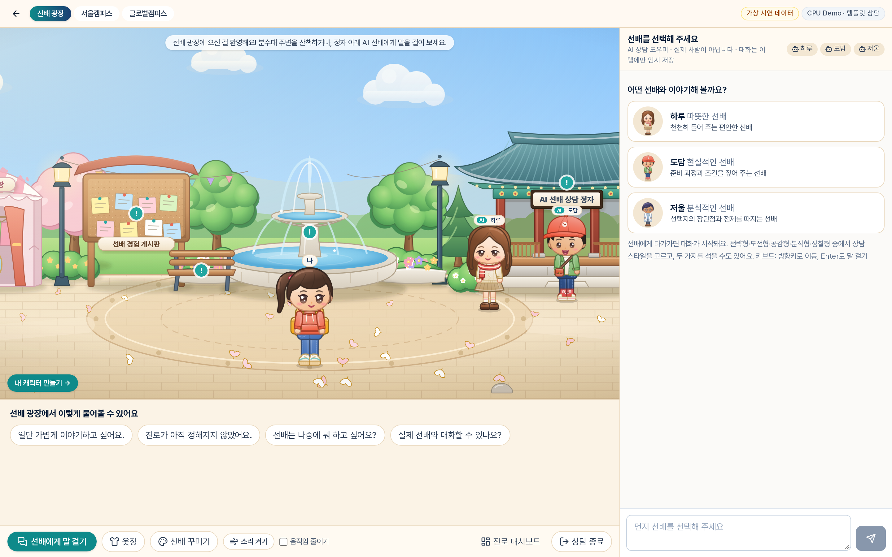
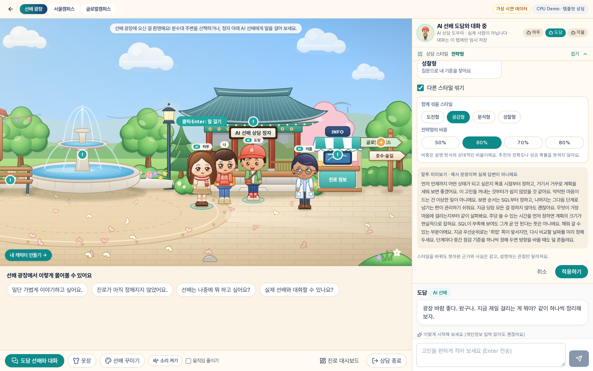
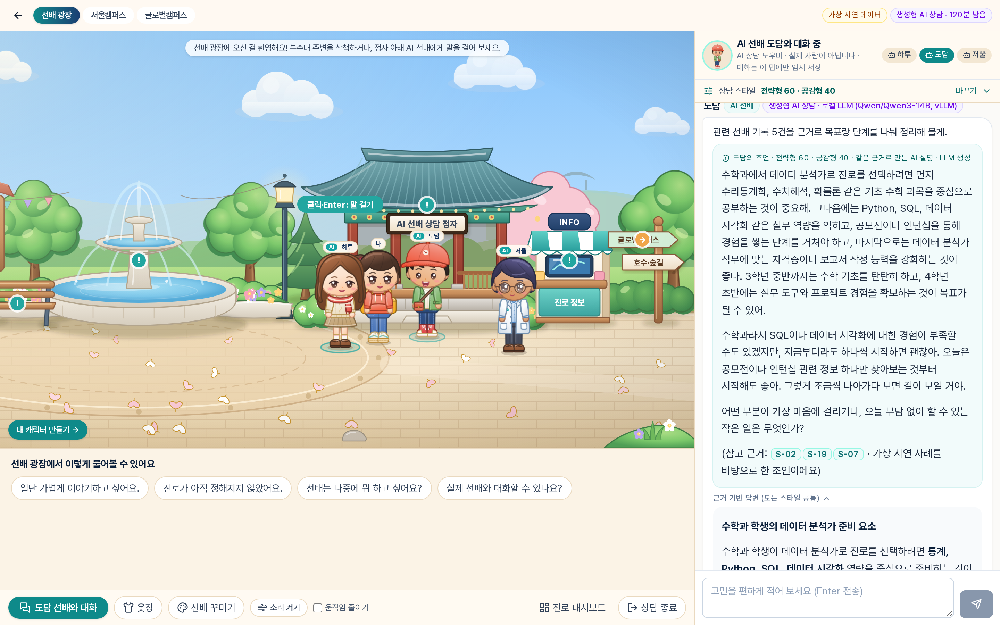
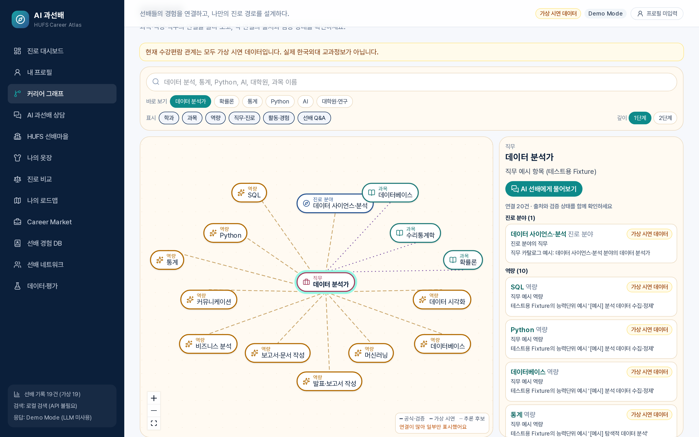
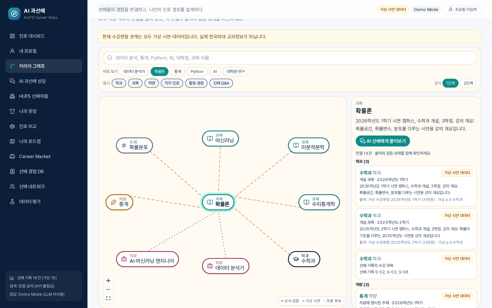

# AI 과선배 · HUFS Career Atlas

> 선배들의 경험을 연결하고, 나만의 진로 경로를 설계하다.

한국외국어대학교 학생을 위한 **근거 기반 진로 상담 프로토타입**입니다. 2D 가상 캠퍼스에서 AI 선배를 만나, 원하는 상담 스타일로 진로 이야기를 나눌 수 있습니다.

> ⚠️ **한국외국어대학교의 공식 서비스가 아닙니다.** 선배 기록 19건, Q&A 10건, 수강편람은 모두 가상 시연 데이터이며 **실제 동문 데이터는 0건**입니다. 직무·채용 정보는 테스트 Fixture입니다. AI 선배는 실제 사람이 아닙니다.



## 학생이 겪는 문제
진로 정보는 흩어져 있고, 나와 비슷한 선배의 경험은 찾기 어렵습니다. 어떤 수업과 경험이 어떤 진로와 이어지는지 한눈에 보기도 힘듭니다. 일반 챗봇은 그럴듯하지만 출처를 확인하기 어렵습니다.

## 해결 방식
가상 캠퍼스라는 친근한 공간에서, 출처를 표시하는 AI 선배와 대화합니다. 사실과 설명 관점을 분리하고, 근거가 없으면 없다고 말합니다.

## 주요 기능
| 영역 | 내용 |
|---|---|
| 가상 캠퍼스 | 선배 광장, 서울·글로벌캠퍼스, 아바타와 옷장 |
| AI 상담 | 질문 분석 → 검색 → 근거 답변 → 인용 검증 |
| 상담 스타일 | 다섯 가지 스타일과 혼합 |
| 진로 도구 | 프로필, 매칭, 진로 비교, 로드맵, Career Market |
| 관계 탐색 | 과목·역량·직무의 연결을 출처와 함께 탐색 |
| 선배 네트워크 | 역할 구분, 경험 등록, 관리자 승인 |
| Q&A 근거 | 승인·동의·개인정보 확인을 통과한 항목만 검색 |

## 핵심 화면
| | |
|---|---|
|  |  |
| Persona Blending 설정 | 혼합 스타일 답변 (실제 LLM) |
|  |  |
| 관계 탐색 (가상 데이터) | 노드 상세와 출처 |

## 다섯 가지 AI 선배 스타일
| 스타일 | 설명 |
|---|---|
| 전략형 | 목표에서 거꾸로 단계와 일정을 세웁니다 |
| 도전형 | 되돌릴 수 있는 작은 시도와 대안을 찾습니다 |
| 공감형 | 마음을 먼저 듣고 작은 행동으로 잇습니다 |
| 분석형 | 근거의 강도와 전제를 따집니다 |
| 성찰형 | 질문으로 자신의 기준을 찾게 돕니다 |

캐릭터 외형과 상담 스타일은 독립적입니다. 스타일이 바뀌어도 근거와 사실 답변은 같습니다.

## Persona Blending
두 스타일을 50~80% 비중으로 섞습니다. 비중은 설명 방식의 상대적 비율이며 정확도나 성공 확률이 아닙니다. CPU Demo에서는 문장 수로 정확히 반영되고, 실제 LLM에서는 혼합이 확인됐지만 **비중 크기 차이의 효과는 검증되지 않았습니다.** ([상세](docs/PERSONA_BLENDING_4_0.md))

## RAG와 Career Knowledge Graph
선배 기록을 임베딩·리랭커 또는 로컬 검색으로 찾고, 학과→과목→역량→경험→직무 그래프로 보여 줍니다. 근거마다 실제/가상과 출처 유형을 표시합니다.

## GraphRAG 고도화 (4.1)
질문에서 개체를 찾아 1~2단계 관계를 탐색하고, 관계를 `[G-xx]`로 인용해 답합니다. 관계에는 출처 등급이 붙고, 과목과 직무의 연결은 '추론 후보'로 표시합니다. 그래프는 요청마다 최신 권한으로 구성되어 동의 철회가 즉시 반영됩니다.

**구현·검증 범위:** 검색, 권한, 화면은 가상 수강편람으로 검증했습니다. 공식 수강편람은 사용 허가를 확인하지 못해 넣지 않았습니다. ([설계](docs/GRAPHRAG_4_1_DESIGN.md), [검증](docs/GRAPHRAG_4_1_VALIDATION.md))

## 기술 스택
Next.js 15, React 19, TypeScript, Tailwind CSS 4, React Flow · (선택) vLLM + Qwen3-14B, FastAPI + BGE-M3·BGE Reranker · Vitest, Playwright

## 설치와 실행
필요: Node.js 22, npm. GPU와 API 키 없이 CPU Demo로 실행됩니다.
```bash
cd web
npm ci
cp ../.env.example .env.local   # Windows PowerShell: copy ..\.env.example .env.local
# .env.local 에서 FEATURE_CAMPUS_LOUNGE, FEATURE_CAREER_INTEL, FEATURE_COURSE_GRAPH 를 1 로 설정
npm run build
npx next start -H 127.0.0.1 -p 3000
```
브라우저에서 http://127.0.0.1:3000/ 을 엽니다. 캠퍼스는 `/campus`, 관계 탐색은 `/graph?view=explore`입니다.

실제 LLM(선택): `pip install -r ml/requirements.txt`로 환경을 만든 뒤 `ml/.venv`에 두고 `LLM_GPU=<GPU 번호> LLM_PORT=8009 bash scripts/start_llm.sh`, 웹에는 `LLM_PROVIDER=local`을 설정합니다. 서버 내부 절대경로에 의존하지 않으며, 저장 파일은 `web/data/`에 생성됩니다.

## 필요한 환경변수
전체 목록은 [.env.example](.env.example)에 있습니다.
| 변수 | 설명 |
|---|---|
| `LLM_PROVIDER` | `demo`(기본), `local`, `openai_compatible` |
| `FEATURE_CAMPUS_LOUNGE`, `FEATURE_CAREER_INTEL`, `FEATURE_ALUMNI_NETWORK`, `FEATURE_COURSE_GRAPH` | 기능 켜기 (기본 꺼짐) |
| `SESSION_SECRET` | 32자 이상 |
| `ADMIN_TOKEN` | 관리자용 |
| `PUBLIC_DEMO` | 외부 공개 잠금 |

## 테스트
```bash
bash scripts/safe_build.sh               # 서버 실행 중이면 빌드 거부
bash scripts/test_servers_4_0.sh start   # 격리 서버 3410~3412
cd web
npx playwright install chromium          # 최초 1회
npx tsc --noEmit && npx eslint src tests
npx vitest run
npx playwright test --project=campus --project=campus-phone --project=campus-off --project=campus-lock --project=full-desktop --project=full-mobile --project=public-demo --project=no-api
cd .. && bash scripts/test_servers_4_0.sh stop
```
최근 결과: 단위 138/138, CPU E2E 27/27, 실제 LLM E2E 1/1. 실제 LLM 테스트(`--project=campus-ai`)는 GPU와 모델이 필요합니다.

## 실제 데이터와 시연 데이터
| 구분 | 표시 | 상담 근거 사용 조건 |
|---|---|---|
| 가상 선배 기록·Q&A·수강편람 | "가상" 표시 | 시연용, 가상이라고 표시 |
| 시연용 선배 계정 | "시연용 계정" | 사용 안 함 |
| 실제 선배 경험·Q&A | "실제 선배" 표시 | 관리자 승인, 동의, 개인정보 확인, 출처 필요 |
| 공식 수강편람 | "공식 원문" | 사용 허가와 출처 URL 필요 (현재 0건) |

## 현재 알려진 한계
- 실제 동문 데이터, 공식 교과정보, 학생 사용자 평가가 없습니다.
- 실제 LLM에서 블렌딩 비중의 크기 효과는 검증되지 않았습니다.
- LLM 답변에 과한 표현이 일부 남을 수 있습니다. 사실 가드는 규칙 기반입니다.
- 저장소는 JSON 파일이며 단일 프로세스 전제입니다. 학교 SSO가 없고, 응답 스트리밍도 없습니다.
- 위기 상황 탐지는 규칙 기반이며 전문가 검토가 필요합니다.

## 향후 확장
학교 허가를 받은 공식 수강편람 연동, 실제 선배 Q&A 수집과 DB 전환, 사용자 평가, 학교생활 상담, 응답 스트리밍.

## 문서
[아키텍처](ARCHITECTURE.md) · [데이터 스키마](DATA_SCHEMA.md) · [검증 4.0](docs/VALIDATION_4_0.md) · [배포 안내](docs/DEPLOYMENT_GUIDE.md) · [GitHub 업로드 안내](docs/GITHUB_UPLOAD_GUIDE.md) · [라이선스 정보](THIRD_PARTY_NOTICES.md)

이 서비스는 대학의 진로 상담과 동문 멘토링을 대체하지 않고 보완합니다.
